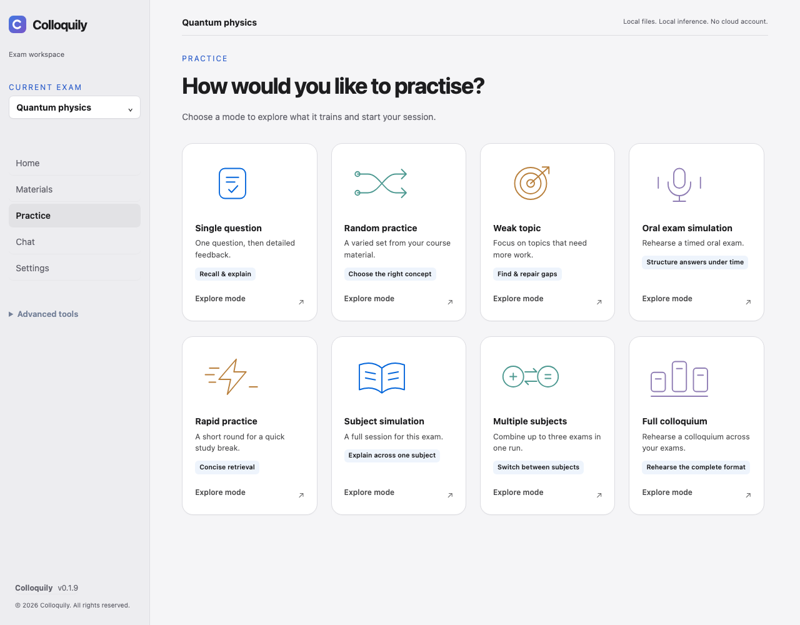
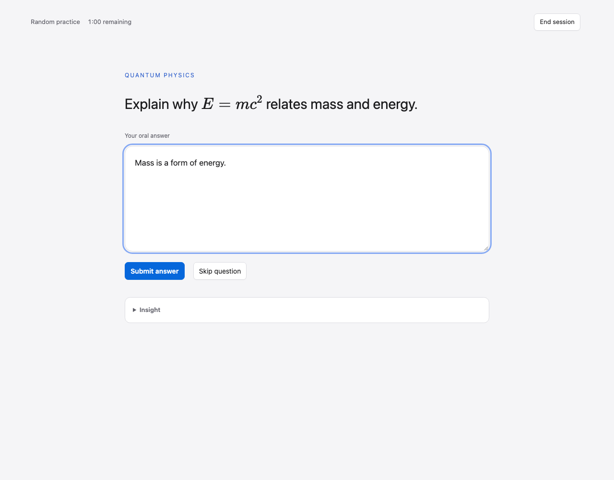
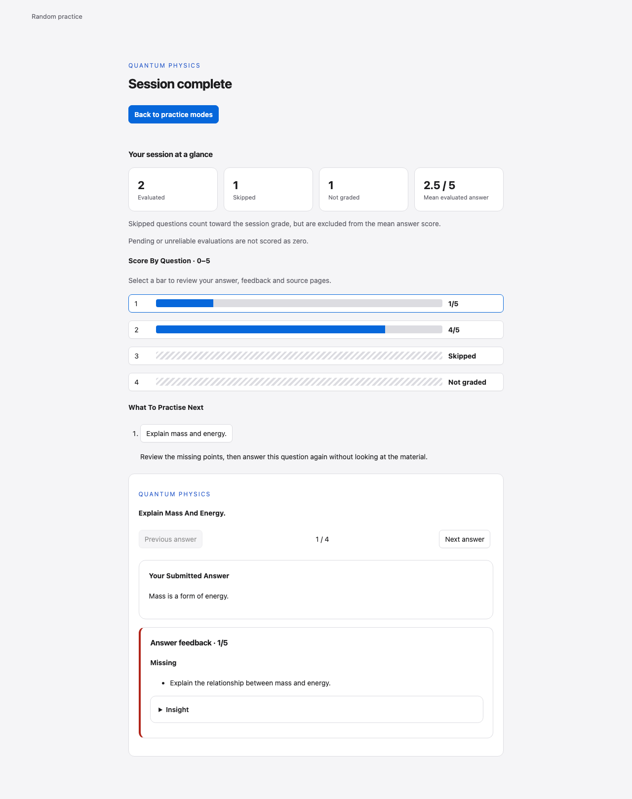

# Colloquily

[](LICENSE)
[](https://github.com/artemkolokoltsev/colloquily/actions/workflows/ci.yml)
[](https://github.com/artemkolokoltsev/colloquily/releases)

[Download](https://github.com/artemkolokoltsev/colloquily/releases) · [User guide](docs/USER_GUIDE.md) · [Installation](docs/INSTALLATION.md) · [License information](docs/LICENSING.md) · [Privacy](docs/PRIVACY.md) · [Architecture](docs/ARCHITECTURE.md)

Colloquily helps you prepare for university oral exams using your own course material. Create an exam, set its date, upload your lecture PDFs, and choose **Prepare my practice**. Colloquily checks the study text and prepares source-grounded questions so you can start practising without managing indexes or review queues.

Your dashboard shows a daily practice plan, topic progress, and activity. Processing, source review, question management, and model configuration remain available under **Advanced tools** or expandable options.

Documents, indexes, answers, and evaluations stay on your computer. There is no analytics service, cloud account, or cloud LLM fallback. Internet access is needed to install the application and explicitly download AI models; inference uses local Ollama (existing LM Studio configurations remain supported by the Python core).



*Current browser UI, captured with synthetic API fixtures. Screenshots demonstrate the interface, not measured AI quality. [Capture details and more views](docs/screenshots/README.md).*

## Choose how to practise

Create an exam → add PDFs or Markdown → **Prepare my practice** → open **Practice**.
Each illustrated mode card opens a guide explaining its learning goal, method and session options. English and German are available without restarting.

| Mode | Use it for | Feedback |
| --- | --- | --- |
| **Single question** | Explain one concept, its reasoning and an example | After your answer |
| **Rapid practice** | Recall familiar ideas concisely in a quick round | After each answer |
| **Weak topic** | Revisit questions due for review, then the remaining pool; uses the usual pool without history | After the run |
| **Random practice** | Recognise the relevant concept across a mixed selection; set count and topic/difficulty/priority filters | After the run |
| **Oral exam simulation** | Rehearse structured answers under time pressure with count and filters | After the run |
| **Subject simulation** | Sustain explanations across one exam's question pool | After the run |
| **Multiple subjects** | Practise switching between two or three exams in consecutive blocks | After all blocks |
| **Full colloquium** | Rehearse exactly three exams; starts with 15 minutes per subject, adjustable in setup | After all blocks |

Deferred evaluation starts automatically when the run finishes. Duration options range from 5 to 90 minutes; preparation counts toward the time limit, and multi-subject durations apply to each subject. Only submitted text is evaluated: speaking aloud is optional rehearsal, and an unsent draft is not submitted on timeout. **Skip** advances without an AI call or feedback; it remains recorded as skipped.

<details>
<summary>See focused practice and session review</summary>





</details>

Use source insights to check the original PDF page, then review submitted answers, scores and suggested follow-ups in the session summary. AI feedback can be wrong; scores are study aids, not predictions of a university grade. The guides explain retrieval practice and self-explanation, with research links and limits. See the [full practice guide](docs/USER_GUIDE.md#what-the-practice-modes-train).

## Engineering highlights

- **Evidence-gated questions:** schema, exact support-quote, numeric-claim and duplicate checks plus a separate local-model validation pass; insufficient support produces a visible failure or incomplete coverage.
- **Exam isolation:** separate workspaces and FAISS indexes, with SQLite records and source provenance scoped to each exam.
- **Durable practice:** transactional attempt/advance updates, expected-question checks for late requests, and idempotent Skip transitions.
- **Local desktop runtime:** React/TypeScript → FastAPI/Python → SQLite/FAISS/Ollama, with Tauri/Rust managing a frozen backend on a token-protected loopback port.
- **Verification and distribution:** deterministic API/domain regressions, frontend utilities and Chromium/WebKit smoke tests, separate real-model acceptance, and native packaging for Windows x64 and both macOS architectures.

Read the [architecture](docs/ARCHITECTURE.md), [engineering case studies](docs/ENGINEERING_CASE_STUDIES.md), [measured baseline and specification review](docs/ENGINEERING_BASELINE.md), [engineering standards](docs/ENGINEERING_STANDARDS.md), and [contribution guide](CONTRIBUTING.md). Test and release limitations are documented alongside the implementation.

## Desktop installation

Desktop previews are distributed through [GitHub Releases](https://github.com/artemkolokoltsev/colloquily/releases). Download the Windows x64 EXE or the DMG matching Apple Silicon/Intel macOS, and its matching `licenses-*.zip` bundle. Verify `SHA256SUMS.txt`. See [installation](docs/INSTALLATION.md), the [user guide](docs/USER_GUIDE.md), [updates](docs/UPDATES.md), and [privacy](docs/PRIVACY.md).

**Desktop previews have release-specific trust status.** Tauri updater signatures and operating-system publisher signing are separate controls. Signed update payloads have been supported since 0.1.6; Apple Developer ID/notarization and Windows Authenticode depend on the credentials and native verification for each release. Check the release assets and [native trust documentation](docs/TRUSTED_RELEASES.md). Packaging CI does not establish clean-machine GUI installation or complete hardware coverage. Operating-system security may warn or block installation; do not disable security globally.

A desktop release contains the React UI, Tauri application, Python runtime, FastAPI backend, and native Python dependencies. End users will not need Python, Node.js, Docker, or a terminal. Install the macOS application or Windows installer, open Colloquily, and follow **AI setup**. The backend starts and stops with the desktop application.

Ollama remains a separate installation. Install it from [Ollama](https://ollama.com/download) and start it. Colloquily checks memory and disk space, reuses suitable installed models, and automatically prepares missing selected models with progress, cancellation and retry. Existing exam-specific task and embedding choices are preserved. Advanced users can change them under **AI setup**.

New-exam defaults range from `qwen2.5:1.5b` on limited hardware to `qwen3:4b` or `qwen3:8b` when resources allow, with `embeddinggemma:latest` for embeddings unless already configured otherwise. Small models can fail quality or coverage checks; the app reports this instead of inserting filler questions. Model weights are not bundled and retain their separate upstream terms. Retry interrupted downloads to reuse cached layers, and keep sufficient free disk space.

## Architecture

```text
React + TypeScript (Vite) → HTTP API → FastAPI
                                      ↓
                        existing Python domain services
                                      ↓
                          SQLite / FAISS / files / Ollama

Tauri v2 → bundled PyInstaller backend → loopback-only listener
```

The frontend contains presentation and API calls, not RAG or persistence logic. FastAPI adapters reuse `backend/core/services/` and the existing database schema. Ingestion retains durable checkpoints; indexing, generation, evaluation, and downloads run as background operations with status polling. Other operation handles are process-local: after a restart, retry the action; completed exam attempts and evaluations remain in SQLite.

The desktop uses a random loopback port and a per-launch API token. Foreign browser origins are rejected. Both the desktop and browser applications open without a login. Existing owner records are reused to preserve progress; new databases use a local identity with a random unused password. Advanced settings provide parsing, chunking, retrieval, and model controls for RAG experiments.

## Development

Requirements: Python 3.11, Node.js 22.13+ (22 LTS) or 24+, and Ollama for inference. Desktop development additionally needs Rust (pinned in `rust-toolchain.toml`) and the [Tauri platform prerequisites](https://v2.tauri.app/start/prerequisites/), including Xcode Command Line Tools on macOS or Microsoft C++ Build Tools/WebView2 on Windows.

macOS shell:

```bash
python3.11 -m venv .venv
source .venv/bin/activate
python -m pip install -r requirements-dev.txt
npm ci
npm run dev:all
```

Windows PowerShell:

```powershell
py -3.11 -m venv .venv
.\.venv\Scripts\Activate.ps1
python -m pip install -r requirements-dev.txt
npm ci
npm run dev:all
```

Browser development runs at `http://127.0.0.1:5173`; Vite proxies `/api` to the loopback backend on port 8765. `make dev` is equivalent on systems with Make. To run the processes separately:

```bash
npm run dev:backend
# In another terminal, with the virtual environment active:
npm run dev
```

FastAPI's interactive API reference is at `http://127.0.0.1:8765/docs` in browser development. Do not run multiple API workers against one data directory. The launcher fixes the bind address to loopback.

## Desktop development and builds

Activate the Python environment first. Build the backend on the **same OS and CPU architecture** as the desktop target; PyInstaller does not cross-compile.

```bash
npm run build:sidecar
npm run tauri -- dev
```

Tauri development launches its own sidecar. Stop `dev:all` first; Tauri starts Vite itself. Rebuild the sidecar after Python changes. Browser mode is faster for routine backend development.

macOS Apple Silicon, from a native ARM Python/Rust environment:

```bash
npm run build:sidecar
npm run tauri -- build --target aarch64-apple-darwin --bundles app,dmg
```

macOS Intel, from a native Intel Python/Rust environment:

```bash
npm run build:sidecar
npm run tauri -- build --target x86_64-apple-darwin --bundles app,dmg
```

Windows x64, from an x64 Python/Rust environment:

```powershell
npm run build:sidecar
npm run tauri -- build --target x86_64-pc-windows-msvc --bundles nsis
```

The script rejects mismatched Python/Rust architectures and writes the target-suffixed executable into `src-tauri/binaries/`. Installers appear under `src-tauri/target/<target>/release/bundle/`. There are no bundled LLM weights, though native Python/ML libraries can make the application sizable. See [desktop packaging](docs/desktop.md) for validation and signing requirements.

## Data and migration

Mutable files always live outside the installed application:

| Mode | Directory |
| --- | --- |
| Browser development | `data/` (compatible with existing data) |
| macOS desktop | `~/Library/Application Support/Colloquily/` |
| Windows desktop | `%APPDATA%/Colloquily/` |
| Explicit override | `COLLOQUILY_DATA_DIR` |

The directory contains `colloquily.db`, `exams/`, model/processing caches, indexes, and saved settings. Application resources and prompts are read-only bundle content. To migrate an existing workspace, stop the old application, back up and copy the **whole data directory** to the desktop location. Do not copy a live SQLite database without its WAL. Colloquily does not silently relocate or delete existing data.

Settings can create a validated `.colloquily-backup` archive using SQLite's online backup API, so WAL state is captured consistently. Backups include documents, records, settings, and relevant indexes while excluding regenerable caches and Ollama weights. Forward migrations create an integrity-checked database snapshot first and reject schemas created by a newer app.

## Checks

With the Python environment active:

`make check` runs deterministic lint, format, strict TypeScript, tests and build.
See [developer verification](docs/DEVELOPMENT.md) for the incremental legacy
baseline, focused commands and troubleshooting. Repository policy and branch
lifecycle are recorded in [maintenance](docs/REPOSITORY_MAINTENANCE.md).

```bash
python scripts/test_core.py
python -m unittest discover -s backend/tests -v
npm test
npm run build
cargo check --locked --manifest-path src-tauri/Cargo.toml
```

`make test` runs the frontend checks and both Python suites. `npm run test:pdf` builds the frontend and runs the synthetic Chromium/WebKit interaction smoke test under the desktop content-security policy; install its browsers with `npx playwright install chromium webkit` first. This test uses HTTP fixtures and needs no inference models. Native checking requires the generated sidecar and icons. The end-to-end verifier is available with `make smoke` and requires configured local inference models. Architecture smoke tests use disposable data and mock model availability; they do not download models.

## Repository layout

```text
frontend/                 React screens, reusable components, typed API client
backend/api/              FastAPI routes
backend/models/           Pydantic API contracts
backend/services/         Workflow adapters, background jobs, LLM setup provider
backend/main.py           Local API lifecycle and access controls
backend/launcher.py       Loopback sidecar entry point
src-tauri/                Desktop lifecycle, capabilities, packaging and icons
scripts/                  Native sidecar build and isolated test runner
backend/core/services/    Exam-scoped ingestion, retrieval, evaluation and storage
backend/core/app_paths.py  Packaged/development data location resolution
tests/core/               Domain regression suite
tests/frontend/           Shared UI pagination and source-viewer regressions
docs/                     Architecture, migration and packaging notes
```

The repository contains only the desktop application and its supporting tools. Study data lives in ignored `data/`; packaged installations use the OS application-data directory. Database migration code is retained to protect existing workspaces.

## License

Original Colloquily code and documentation are licensed under [Apache-2.0](LICENSE).
Dependencies retain their own licenses. Full third-party notices, target-specific
inventories and MPL-covered sources are packaged with installers and release
license bundles. See [licensing and redistribution](docs/LICENSING.md). PDFium is
used instead of PyMuPDF; the distribution checks reject AGPL dependencies.
Model weights and personal course documents are not bundled or relicensed.

Permanent website installer URLs and update-channel setup: [Download integration](docs/DOWNLOADS.md).
