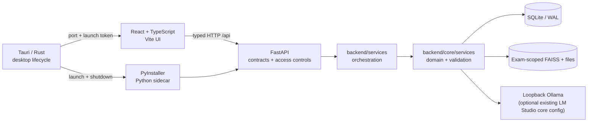
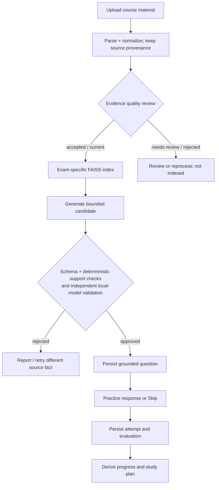

# Architecture

This document describes the **implemented** Colloquily 0.1.10 design, not an aspirational service architecture. Start with the [README](../README.md) for installation and the [engineering standards](ENGINEERING_STANDARDS.md) for change invariants.

## Context and responsibilities

Colloquily is an offline-capable, single-user study desktop application. Students supply their own exam materials; local services prepare evidence, generate questions, run practice, and persist learning history. Model downloads are a separate, user-initiated online action.

The browser development mode talks directly to the loopback FastAPI service. Desktop mode starts a local Python process and passes its connection details to the webview via a restricted Tauri command. The frontend does not own inference, source approval, or database state.

## Code map

| Concern | Entry points | Responsibilities |
| --- | --- | --- |
| Application lifecycle and trust boundary | `src-tauri/src/main.rs`, `backend/launcher.py`, `backend/main.py` | Child process lifecycle, loopback port, launch token, origin/host checks, request gating |
| HTTP contract | `backend/models/api.py`, `backend/api/routes.py`, `frontend/src/api/client.ts`, `frontend/src/types/index.ts` | Validated payloads, routes, typed calls and error display |
| Exam workflows | `backend/services/workflows.py`, `backend/services/preparation.py`, `backend/services/jobs.py` | Compose domain operations and expose progress |
| Ingestion and evidence quality | `backend/core/services/quality_pipeline.py`, `knowledge_repository.py`, `processing_jobs.py` | Parse, normalize, review, checkpoint and approve evidence |
| Retrieval and generated questions | `subject_index.py`, `subject_rag.py`, `grounded_training.py`, `question_evidence.py` | Per-exam retrieval, source validation, duplicate/quality gates |
| Practice, mastery and planning | `exam_state.py`, `progress.py`, `study_plan.py` | Durable attempts, evaluation and derived progress |
| Persistent storage | `database.py`, `subject_workspace.py`, `backend/services/backups.py` | SQLite migrations/transactions, exam folders, backups |
| Local AI adapters | `local_models.py`, `llm/`, `embeddings/`, `backend/services/models.py` | Model selection, local requests and setup |
| Presentation | `frontend/src/features/`, `components/`, `app/App.tsx` | Student workflows, advanced tools, accessibility and navigation |

The `backend/core/` package is a preserved domain layer. `backend/__init__.py` registers its legacy import path as a compatibility adapter. This is a current trade-off, not a recommended pattern to expand.

## Preparation and practice

The generated-question contract includes evidence identifiers, answer points, and exact supporting quotes. Deterministic gates check citation membership, supporting quotes, unsupported numeric claims, clarity and duplicates before additional model-based validation. Model output is not a source of truth by itself. If material is insufficient, the application must communicate that result rather than manufacturing plausible-looking questions.

## Data isolation and durability

- SQLite is the system of record for exams, review decisions, attempts, and progress. WAL and explicit transactions protect state changes.
- Each exam has a separate workspace/index. Only accepted, current units are eligible for retrieval; historical questions and review decisions remain available without silently satisfying current evidence coverage.
- Long-running ingestion records durable checkpoints. Other background operations may have process-local handles; after a restart, the user retries them. Completed attempts remain persisted.
- Skip is a synchronous, idempotent transition: it records an ungraded attempt and advances the session transactionally. The answer's expected question ID prevents a delayed submission from grading a subsequent question.
- User files live in application-data directories (or the explicit override), not the application bundle. Migrations take integrity-checked snapshots; backups use SQLite's online backup API.

## Trust boundaries

1. **Desktop to API:** Rust starts the sidecar; API is loopback-bound and packaged requests require a fresh token. Host and browser Origin are validated.
2. **Documents to domain:** uploaded filenames, sizes, paths and extracted text are untrusted. Normalization never erases raw provenance.
3. **Local model to product:** outputs are untrusted candidates. Validate schemas, evidence and state before persistence.
4. **Updater and release:** downloads, signing and distribution are separate from private learning data. The app does not bundle model weights or course documents.

See [security review](security-review.md), [privacy](PRIVACY.md), and [desktop packaging](desktop.md). This is **not** a hardened multi-user network service.

## Intentional trade-offs and known limits

| Decision | Benefit | Cost or limit |
| --- | --- | --- |
| Local-only inference | Privacy and offline study after model setup | Hardware-dependent latency and generation quality; model downloads require internet |
| SQLite + exam-scoped FAISS | Simple deployable desktop storage and retrieval | Not designed for multi-user concurrent writes; avoid multiple API workers |
| Tauri + frozen Python sidecar | Native distribution while retaining mature Python ML tooling | Large native artifacts and target-specific packaging/signing complexity |
| Layered compatibility with existing Python core | Preserves working domain logic and historical workspaces | Import-path compatibility needs care; some domain modules remain large |
| Source-gated generation | Clear, testable evidence lineage | Can reject plausible questions or produce too few questions with weak source material |
| Deterministic regressions plus separate real-model acceptance | Fast feedback and a grounded AI-quality signal | Model acceptance is slower and can vary; neither test set proves learning outcomes |

Native packaging and clean-machine GUI validation are different gates. Signed updater artifacts do not establish Apple notarization or Windows publisher trust; consult release-specific native verification in [trusted releases](TRUSTED_RELEASES.md). The [desktop checklist](desktop.md) tracks remaining release requirements.

## Change guide

Follow the [contributing guide](../CONTRIBUTING.md), [standards](ENGINEERING_STANDARDS.md), and scoped `AGENTS.md` files. Architecture changes should add a short decision record under `docs/adr/`; behavior changes need focused regression tests and updated contracts.
